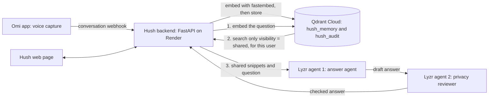

# Hush

**Voice memory that listens only as much as you allow.**

Hackathon: Stop Prompting, Solo Agents (AI House x HiDevs)
Build track: **Privacy-First Knowledge Systems**
Stack: **Omi + Qdrant + Lyzr**

- Live app: https://hush-voice-memory.onrender.com
- Demo video: `<paste video link here>`
- Repository: https://github.com/arsheensyeda/hush-voice-memory

> The app runs on a free Render instance that sleeps when idle. If the page is slow to open, wait up to a minute for it to wake.

---

## The idea

Voice assistants that remember everything you say are useful, and uncomfortable. Most of them send everything they hear to an AI.

Hush keeps your spoken memories in a vector database, and lets you decide, memory by memory, what an AI agent is ever allowed to see:

- **Private** memories are stored but never sent to any agent.
- **Shared** memories can be retrieved and used to answer your questions.

The interface shows this as a marked-up document. Private memories are blacked out like a redacted page, and shared memories are highlighted. After every question, Hush shows exactly what the agents saw and how many memories were kept from them.

## How it works



**Asking a question**

1. The question is embedded locally with `fastembed` (BAAI/bge-small-en-v1.5, 384 dimensions).
2. Qdrant searches for the closest memories, filtered to the same user **and** `visibility = shared`. Private memories are excluded by the database query, not by asking an AI to behave.
3. The shared snippets and the question go to the Lyzr **answer agent**, which drafts a reply.
4. The draft goes to the Lyzr **privacy reviewer** agent, which checks every claim against the shared context and strips anything unsupported or unnecessarily sensitive.
5. The reply is returned together with each agent's step, the snippets that were used, and the number of private memories withheld.

## How the three required tools are used

### Omi: voice input
Omi captures conversations from the phone microphone or the Omi device. When a conversation finishes, Omi calls the Hush webhook at `POST /omi/conversation?uid=...`. Hush stores the conversation summary and transcript as a memory under that Omi user ID. Memories that arrive from Omi are **private by default**, so nothing reaches an agent until the user chooses to share it.

### Qdrant: persistent vector memory
Qdrant Cloud holds two collections:

- `hush_memory`: one point per memory. The vector is the embedded text. The payload holds `uid`, `text`, `source`, `visibility` and a timestamp. Payload indexes on `uid` and `visibility` make the privacy filter fast.
- `hush_audit`: one point per event in the audit log (payload only, with a placeholder vector).

Qdrant is also where privacy is enforced: the retrieval query filters on `visibility = shared`, deleting a memory removes its point, and changing visibility updates the payload in place.

### Lyzr: multi-agent reasoning
Two agents, built in Lyzr Agent Studio, are called by the backend over the Lyzr chat API:

1. **Answer agent**: answers only from the shared context.
2. **Privacy reviewer**: receives the context, the question and the draft, then removes anything unsupported or unneeded and appends a one-line review verdict.

The agents coordinate through the shared retrieval context that comes out of Qdrant. Each question uses a fresh Lyzr session, so a memory that is later made private cannot linger in an old chat history.

## Privacy features

| Feature | How it works |
|---|---|
| Private by default | Omi captures start as `private`. |
| Per-memory visibility | Switch any memory between Private and Shared at any time. |
| Enforced at the database | Agents only receive what Qdrant returns for `visibility = shared`. |
| Forget | Deleting a memory permanently removes its point from Qdrant (two-tap confirmation in the UI). |
| Second-agent check | The privacy reviewer strips unsupported or unnecessary detail before the answer is shown. |
| Fresh agent sessions | No chat history carries memories between questions. |
| Transparent answers | Every answer shows the snippets the agents saw and the count of private memories withheld. |
| Audit log | Every action is logged. The log stores event types, ids and counts, never memory text. |
| Plan B | If the agents are unreachable, Hush falls back to showing the best-matching shared memories. Private memories still stay private. |

## Observable workflow

Each step is visible in three places:

- the API response from `POST /ask` includes `steps` (one entry per agent), `shared_used` and `private_withheld`;
- the **Activity** panel in the web page lists logged events in plain language;
- the server prints a `[hush] ...` line for each stage (question received, memories retrieved, agent answered, agent reviewed).

## Run it locally

Requirements: Python 3.10 or newer, a Qdrant Cloud cluster (the free tier works), and two agents created in Lyzr Agent Studio.

```bash
git clone https://github.com/arsheensyeda/hush-voice-memory.git
cd hush-voice-memory
python -m venv venv
# Windows: venv\Scripts\activate    Mac/Linux: source venv/bin/activate
pip install -r requirements.txt
cp .env.example .env     # Windows: copy .env.example .env
# fill in .env, then:
uvicorn app:app --reload --port 8000
```

Open http://localhost:8000. Interactive API docs are at http://localhost:8000/docs.

### Environment variables

| Name | What it is |
|---|---|
| `QDRANT_URL` | Qdrant Cloud cluster URL |
| `QDRANT_API_KEY` | Qdrant Cloud API key |
| `LYZR_API_KEY` | Lyzr Agent Studio API key |
| `LYZR_AGENT_ID` | ID of the answer agent |
| `LYZR_REVIEWER_AGENT_ID` | ID of the privacy reviewer agent |

No keys are committed. If the Lyzr values are empty, Hush runs in fallback mode.

## Deploy

The app is deployed as a Render web service:

- Build command: `pip install -r requirements.txt`
- Start command: `python -m uvicorn app:app --host 0.0.0.0 --port $PORT`
- Environment variables: the five above, plus `PYTHON_VERSION=3.11.9`

### Connect Omi

In the Omi app, open Developer settings and set the conversation (memory creation) webhook to:

```
https://hush-voice-memory.onrender.com/omi/conversation
```

## API

| Method and path | Purpose |
|---|---|
| `GET /` | Web interface |
| `GET /health` | Health check |
| `POST /omi/conversation?uid=...` | Omi webhook, stores a private memory |
| `POST /memories` | Add a memory (`uid`, `text`, `visibility`) |
| `GET /memories?uid=...` | List a user's memories |
| `PATCH /memories/{id}` | Change visibility (`uid`, `visibility`) |
| `DELETE /memories/{id}?uid=...` | Forget a memory permanently |
| `POST /ask` | Ask a question (`uid`, `question`) |
| `GET /audit?uid=...` | Read the audit log |

## Tech stack

Python, FastAPI, Uvicorn, fastembed, Qdrant Cloud, Lyzr Agent Studio, Omi, plain HTML, CSS and JavaScript for the interface, Render for hosting.

## Known limitations

- **No login.** A user ID acts as the key to a user's memories. Omi user IDs are long and random, which is enough for a hackathon demo, but a real product would add authentication.
- **Only finished conversations.** Hush listens to Omi's conversation-finished webhook. Real-time transcript streaming is not implemented.
- **Free hosting sleeps.** The first request after idle time can take up to a minute.
- **Retrieval depth.** Each question uses the five closest shared memories.

## Author

Built solo by [Arsheen Syeda](https://github.com/arsheensyeda).
